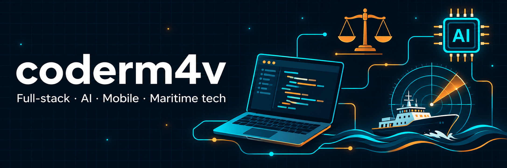

  

<h2 align="center">Xin chào, mình là Thiên 👋</h2>

  Full-stack · iOS / Android · AI builder · IoT · Bảo mật ứng dụng 
  Làm từ web, app di động, firmware ESP32 tới hệ thống bản đồ thời gian thực cho hàng chục nghìn tàu thuyền. 
  Thích biến những bài toán đời thường thành sản phẩm dùng được ngay.

  
  
  

---

## 🧭 Về mình

- 🌊 Làm phần mềm cho **ngành hàng hải**: giám sát tàu thuyền, AIS, vệ tinh, cứu nạn, mô phỏng đào tạo GMDSS.
- 📱 Làm **app di động** native và đa nền tảng: Swift/SwiftUI, Kotlin, Flutter.
- 🤖 Đưa **AI vào sản phẩm thật**: chấm bài tự luận, hỏi đáp có dẫn nguồn, nhận diện ảnh, giọng đọc tiếng Việt có cảm xúc, AI chạy offline trên vi điều khiển.
- 🎓 Làm **nền tảng dạy học online**: học Toán cá nhân hóa, luyện ngoại ngữ, game học luật, LMS cho doanh nghiệp.
- 🛡️ Quan tâm **bảo mật ứng dụng**: sửa lỗi theo pentest, chống spam/DDoS, chống bẻ khóa, giấu backend.
- 🧑‍🔬 Hướng dẫn học sinh làm **sản phẩm STEM**: ESP32, cảm biến, AI nhận diện.
- ⚡ Làm việc cùng **nhiều AI agent song song** để đi nhanh từ ý tưởng tới bản chạy thật.

---

## 🚀 Dự án nổi bật

### 🎓 Giáo dục & Dạy học online

<b><a href="https://hocluat.vercel.app">Hồ Sơ Đời Thường</a></b> · game học luật kiểu visual novel

- 10 vụ việc đời thường (va chạm giao thông, lấn đất, vay qua tin nhắn, lừa đảo giả danh, ly hôn, nợ lương…), mỗi vụ **3 vai** để chọn.
- Người chơi tự viết câu trả lời, **AI chấm điểm** trong ~5 giây và dẫn đúng điều luật; cốt truyện rẽ nhánh theo cách xử lý.
- **Tủ luật 82 điều**, 7 lĩnh vực, ô **Hỏi AI về luật** chỉ trả lời trong phạm vi luật có trong tủ.
- Giọng đọc cho mọi câu thoại, nhân vật nhiều biểu cảm, cộng đồng, bảng xếp hạng.
- `React` `TypeScript` `.NET` `SQL Server` `LLM` `TTS` `Vercel`

<b>MathVTS</b> · học Toán THCS cá nhân hóa

- Phân tích dữ liệu làm bài để chỉ ra điểm mạnh, điểm yếu theo từng chủ đề, gợi ý lộ trình ôn riêng cho từng học sinh.
- Nhiều tài khoản, vai trò học sinh và giáo viên, chạy local-first.
- `React` `TypeScript` `Vite`

<b>EQ Super</b> · luyện trí tuệ cảm xúc qua tình huống

- 230 bài tập, 194 nhân vật; nhân vật nói câu nào thì hiện bong bóng và đọc câu đó, giọng có cảm xúc.
- `Next.js` `TypeScript` `TTS tiếng Việt`

<b>GocSim</b> · mô phỏng đào tạo GMDSS GOC/ROC trên web

- Mô phỏng máy VHF DSC, thoại, bảng báo nạn, NAVTEX và đài bờ ảo theo chương trình IMO Model Course 1.25/1.26.
- Bài tập do máy chủ chấm điểm, phân quyền, hạn dùng tài khoản.
- `.NET` `Web`

<b>AI Education · Luyện chính tả tiếng Trung · LMS doanh nghiệp</b>

- **AI Education**: Gemini tự sinh câu hỏi từ video, hình ảnh; trả lời bằng trắc nghiệm hoặc giọng nói.
- **Chép chính tả tiếng Trung**: nghe, gõ lại chữ Hán, chấm từng chữ theo cấp độ HSK.
- **E-learning doanh nghiệp**: đánh giá, nâng cấp hệ thống LMS, bài giảng có giọng đọc.
- **Game 3D School**: khuôn viên trường 3D nhiều người chơi, chat theo khoảng cách.
- `TypeScript` `Gemini` `Three.js` `Moodle` `WebSocket`

### 📱 iOS & Mobile

<b>Ứng dụng Thuyền trưởng (iOS native)</b>

- Port nghiệp vụ từ Android sang **Swift / SwiftUI**: tab navigation, quản lý tàu, tin nhắn qua vệ tinh.
- Nhận khung dữ liệu từ thiết bị vệ tinh ST6100, kiểm tra **CRC16**, phân tích bản tin; kết nối **BLE**.
- `Swift` `SwiftUI` `BLE` `XCTest`

<b>Nhật ký khai thác · Quản lý vệ tinh · Nạp firmware OTG · AI Vision</b>

- App nhật ký khai thác thủy sản, app quản lý thiết bị vệ tinh, app nạp firmware qua cáp OTG: **Flutter**, chạy cả iOS lẫn Android.
- **AI Vision**: app nhận diện hình ảnh bằng camera.
- **CircleToSearch**: khoanh vùng trên màn hình để tìm kiếm và dịch chồng lên ảnh như Google Lens.
- **Bàn phím tùy biến** cho Android.
- `Flutter` `Dart` `Kotlin` `Swift`

### 🤖 Ứng dụng AI

<b>Thị giác máy tính</b>

- **Nhận diện biển số xe** Việt Nam bằng YOLO11, huấn luyện trên Colab, có giao diện web.
- **FoodGym AI**: chĩa camera vào món ăn, thẻ dinh dưỡng nổi lên trên từng món (calo, đạm, điểm sức khỏe).
- **WinLens**: dịch chữ ngay trên màn hình Windows, tại chỗ.
- `Python` `YOLO` `OpenCV` `TypeScript`

<b>Giọng nói & ngôn ngữ</b>

- **Trợ lý giọng nói ESP32-S3** với từ đánh thức “Meo Meo”, AI chạy **offline** trên chip (Edge Impulse, mic I2S).
- Sinh giọng đọc tiếng Việt hàng loạt có cảm xúc cho bài học, truyện.
- Kiểm tra chính tả, tóm tắt tài liệu Word/PDF; extension kiểm tra chính tả PDF.
- `ESP32-S3` `Edge Impulse` `TTS` `React`

<b>AI Agents & công cụ cho lập trình viên</b>

- Điều phối nhiều AI agent làm song song trên cùng dự án: tách nhánh, review chéo, test, tự deploy.
- **MCP server cho Outlook** (Go): cho trợ lý AI đọc, quản lý lịch và email qua Microsoft Graph.
- **AutoTest bằng AI**: tự kiểm thử web bằng browser agent.
- Ứng dụng tử vi, an sao lập lá số có luận giải AI.
- `TypeScript` `Go` `Python` `MCP` `FastAPI`

### 🚢 Hàng hải & Bản đồ thời gian thực

<b>Giám sát phương tiện thủy · Báo động cứu nạn · Nền tảng giám sát hàng hải</b>

- Bản đồ **WebGL** hiển thị hàng chục nghìn tàu, cập nhật AIS liên tục, icon trượt mượt.
- Cảnh báo sai tuyến, sai điểm neo, quá hạn lưu trú; đồng bộ ~170.000 phương tiện.
- Tối ưu: mỗi lần làm mới từ **2,7 MB / 4–9 giây còn ~100 KB / ~20 ms**.
- Nền tảng giám sát mới: modular monolith **ASP.NET Core 8 + PostGIS + Redis**, Docker.
- `React` `OpenLayers WebGL` `.NET` `SQL Server` `PostgreSQL/PostGIS` `Redis` `Docker`

### 🔧 IoT, Extension & Tự động hóa

<b>Phần cứng, extension và tool</b>

- IoT **ESP32**: tự bật tắt đèn quạt theo người và ánh sáng, đo điện năng, hộp thư thông minh.
- Extension Chrome: tự điền Google Form, tỷ giá ngân hàng.
- Bot Zalo, tool đổi tên hàng loạt file scan theo nội dung (OCR), website bảo tàng số cổ vật, showroom nội thất.
- `ESP32` `Arduino` `C/C++` `Chrome Extension` `Node.js` `Next.js`

---

## 🛡️ Bảo mật & Phòng chống hack

Những thứ mình đã làm thật trên sản phẩm:

| Mối nguy | Cách xử lý |
|---|---|
| Spam, DDoS, bot gọi API tốn tiền AI | Giới hạn theo **từng người dùng** + trần theo IP, hạn mức theo ngày cho API gọi AI |
| Lộ địa chỉ backend | Frontend trên Vercel, **proxy có khóa bí mật**, backend trả 404 với mọi yêu cầu không có khóa |
| Lỗ hổng từ báo cáo pentest | Bỏ mật khẩu mặc định, siết xác thực, giới hạn tần suất đăng nhập |
| Nội dung xấu từ người dùng | **AI kiểm duyệt** bình luận, lọc từ tục, báo cáo vi phạm |
| Lộ khóa API, thông tin máy chủ | Khóa chỉ nằm trên server, ẩn header máy chủ, chặn tải file thô |
| App bị bẻ khóa, sửa đổi | Kiểm tra toàn vẹn, làm rối mã, chuyển logic nhạy cảm lên server |

### 🔍 Reverse Engineering (phục vụ phòng thủ)

- Phân tích ứng dụng Android: APK, thư viện native `.so`, luồng đăng nhập, cách app nói chuyện với máy chủ.
- Mục tiêu: hiểu kẻ tấn công nhìn thấy gì để **bảo vệ app của mình** tốt hơn.
- `jadx` `Ghidra` `IDA` `Frida` `ARM64`

---

## 📚 Khóa học & Chia sẻ

| Khóa học | Nội dung |
|---|---|
| 🛡️ **Chống crack & bảo vệ ứng dụng** | App bị bẻ khóa như thế nào, cách chống: kiểm tra toàn vẹn, làm rối mã, chống debug, đưa logic lên server |
| 🔍 **Reverse Engineering ứng dụng di động** | Đọc APK, thư viện native, debug động với Frida, trên app của chính mình |
| 🔐 **Bảo mật & phòng chống hack cho web/app** | Pentest cơ bản, chống spam/DDoS, giấu backend, bảo vệ API key, kiểm duyệt nội dung |
| 🤖 **Lập trình cùng AI Agent** | Chia việc cho nhiều agent, viết spec, review, test, tự deploy |
| 📱 **Làm app iOS với SwiftUI** | Từ app shell tới BLE, xử lý dữ liệu thiết bị, đưa lên TestFlight |
| 🧑‍🔬 **STEM & IoT cho học sinh** | ESP32, cảm biến, Wi-Fi, AI nhận diện cho dự án thi STEM |

> 📩 Quan tâm khóa học hoặc hợp tác: nhắn mình qua GitHub.

---

## 🛠️ Công nghệ

**Frontend** 

**Mobile** 

**Backend & Database** 
 

**AI & Dữ liệu** 

**Firmware & Hệ thống** 

**DevOps & Công cụ** 

---

## 📊 Thống kê

  

  

<i>“Code để giải quyết chuyện thật, cho người thật.”</i>

